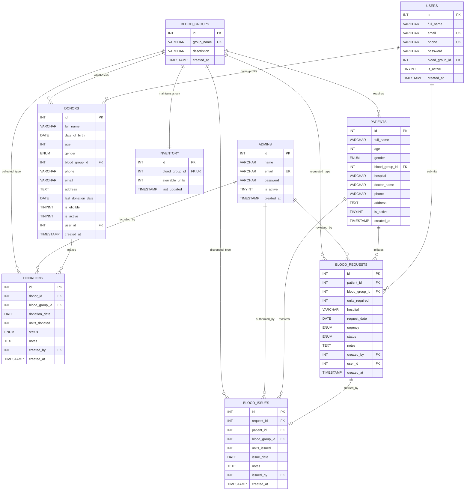

# Blood Bank Management System

DBMS lab mini project. It's a web app for a blood bank: staff can manage donors, patients,
donations, blood requests and issues, and there's a small public site where people can
check stock, register to donate, request blood and track their request.

Stack: React + Vite on the frontend, Node/Express for the API, MySQL for the database.
Login uses JWT and passwords are hashed with bcrypt. Public accounts use two-factor login: a password plus a
one-time code emailed through Gmail or [Resend](https://resend.com). Signing up also needs the emailed code to confirm the
address, and a forgotten password can be reset with an emailed code. Icons are from [Phosphor Icons](https://phosphoricons.com)
by Helena Zhang and Tobias Fried (MIT licence).

## Database

Database name is `blood_bank_db`. There are 10 tables:

- `blood_groups` - the 8 blood groups (A+, A-, B+, B-, AB+, AB-, O+, O-). Other tables point to this.
- `admins` - staff accounts
- `users` - public site accounts (sign up / log in). `donors.user_id` and `blood_requests.user_id` link records to the account that made them.
- `otp_codes` - emailed one-time codes for sign up / login / password reset. Only a keyed hash of each code is stored, and codes expire after 10 minutes.
- `donors` - donor details, last donation date, eligibility. Age has to be 18-65.
- `patients` - patients who need blood (hospital, doctor etc.)
- `inventory` - one row per blood group with the number of units available
- `donations` - every donation. Adding one increases the inventory.
- `blood_requests` - requests for a patient, with urgency (Normal/Urgent/Critical) and status (Pending/Approved/Fulfilled/Rejected)
- `blood_issues` - blood actually given out against a request. This reduces the inventory.

Full schema is in `database/schema.sql` and sample data in `database/seed.sql`.

### ER diagram



### Constraints

Some CHECK constraints we added:

- `chk_donor_age` - donor age between 18 and 65
- `chk_units_non_negative` - inventory can't go below 0
- `chk_donation_units` - 1 to 3 units per donation
- `chk_request_units` - 1 to 10 units per request

Foreign keys are used everywhere instead of storing blood group names as text. Donors and
patients are not actually deleted, we just set `is_active = 0` so old donation/issue records
don't break.

### Transactions

Issuing blood (`POST /api/issues`) is done inside a transaction because two staff could try to
issue the same units at the same time:

1. `beginTransaction()`
2. `SELECT available_units FROM inventory WHERE blood_group_id = ? FOR UPDATE` (locks the row)
3. If there aren't enough units -> `rollback()` and return an error like
   "Insufficient O+ blood available. Available: 1 unit(s). Requested: 2 unit(s)."
4. Otherwise insert into `blood_issues`, subtract from `inventory`, mark the request as
   `Fulfilled`, then `commit()`

Recording a donation works the same way (insert donation, add to inventory, update donor's
last donation date, commit).

Stock status shown on the site: 0 units = Critical, 1-2 = Low Stock, 3 or more = Available.

## How to run

You need Node.js (18+) and MySQL 8 running on port 3306.

**1. Set up `.env`**

Copy `server/.env.example` to `server/.env` and put your MySQL password:

```
DB_HOST=localhost
DB_USER=root
DB_PASSWORD=your_mysql_password
DB_NAME=blood_bank_db
DB_PORT=3306
JWT_SECRET=any_random_string
PORT=5000
GMAIL_USER=yourname@gmail.com
GMAIL_APP_PASSWORD=abcd efgh ijkl mnop
```

Sign up, log in and "forgot password" send a 6-digit code by email. Two ways to send it:

- **Gmail (simplest, emails anyone).** Turn on 2-Step Verification for the Google account, create an app password at
  https://myaccount.google.com/apppasswords, and put the address and app password in `GMAIL_USER` / `GMAIL_APP_PASSWORD`.
  Codes come from that Gmail address. Personal Gmail accounts can send about 500 emails a day.
- **[Resend](https://resend.com)**, used when the Gmail settings are empty: set `RESEND_API_KEY`. Until you verify a domain
  at resend.com/domains, the default `onboarding@resend.dev` sender can only deliver to the email address your Resend
  account was registered with. With a verified domain, set `MAIL_FROM` to an address on it.

If neither is set, the code is printed in the server console instead (local development only). On startup the server
logs which one it is using, and for Gmail whether the login worked.

**2. Create the database**

```
cd server
npm install
npm run setup-db
```

or run the SQL files yourself:

```
mysql -u root -p < database/schema.sql
mysql -u root -p < database/seed.sql
```

Default admin login: `admin@bloodbank.com` / `admin123`

If you already have the database from before, you don't need to run setup again. The server adds the
`users` table, `user_id` columns, `users.token_version` and the `otp_codes` table by itself on startup
(`server/utils/migrate.js`).

**3. Start the backend**

```
cd server
npm start
```

Runs on http://localhost:5000 (check http://localhost:5000/api/health if it's working).

**4. Start the frontend** (in another terminal)

```
cd client
npm install
npm run dev
```

Open http://localhost:5173.

- `/` is the landing page. It's also the login page for public accounts (`/login` opens the same page).
  Staff use the "Admin login" link under the form, or go to `/admin/login`.
- Public site: `/home`, `/availability`, and (after logging in) `/donate`, `/request-blood`, `/track`
- Public accounts: `/signup`, `/account`, `/reset-password` (forgot or change password)
- Admin panel: `/admin`, `/admin/donors`, `/admin/donations`, `/admin/patients`,
  `/admin/requests`, `/admin/issues`

From the project root you can also run `npm run dev:server` and `npm run dev:client`.

The helpline number, email and address on the public site can be changed in
`client/src/config/site.js`.

## API

Routes marked * need the admin JWT token. User tokens and admin tokens are separate (`role` in the token),
so a public user can't call admin routes. Admin tokens last 24 hours, user tokens 7 days.

Every request with a token also checks the account in the database, so a session ends straight away (401)
when the account is deactivated or, for public accounts, when the password is reset. The frontend then
clears that session and sends the person back to the right login page.

Passwords need at least 8 characters. Password logins allow 20 failed attempts per IP every 15 minutes.

Auth
- `POST /api/auth/login` - `{ email, password }`
- `GET /api/auth/me` *

Public
- `GET /api/public/overview` - counts and stock per group
- `POST /api/public/blood-request` - needs user token. Creates a patient + pending request linked to that account

Users (public accounts)
- `POST /api/users/signup/request-otp` - `{ full_name, email, phone, password, blood_group_id }`. Emails a code;
  nothing is created until the code is verified.
- `POST /api/users/signup/verify` - `{ email, code }`. Creates the account and returns the user token.
- `POST /api/users/login` - `{ identifier, password }`, identifier is email or phone. Step 1 of 2: a correct password
  doesn't return a token, it emails a login code and returns the (masked) address it went to. Call it again to resend.
- `POST /api/users/login/verify` - `{ identifier, code }`. Step 2 of 2: returns the user token.

Codes last 10 minutes, allow 5 wrong tries, and a new one can be requested after 60 seconds (max 5 per hour per email).
Login codes are only sent after the right password, so logging in always needs both the password and the inbox.
- `POST /api/users/password/request-otp` - `{ email }`. Emails a password reset code if the account exists. The response is the same either way.
- `POST /api/users/password/reset` - `{ email, code, password }`. Sets the new password, signs out every other
  session for the account and returns a new user token.
- `GET /api/users/me` - needs user token. Returns the profile, own donor profile, donations and requests.
  The Track page uses this, so a user only ever sees records linked to their own account.

Inventory
- `GET /api/inventory`
- `GET /api/inventory/:bloodGroup`

Donors *
- `GET /api/donors`, `GET /api/donors/:id`, `POST /api/donors`, `PUT /api/donors/:id`, `DELETE /api/donors/:id`

Donations *
- `GET /api/donations`, `GET /api/donations/:id`, `POST /api/donations`
- `POST /api/donations/public-signup` - needs a user token, not admin. Books a donation for the logged-in
  user, using the phone number on their account

Patients *
- `GET /api/patients`, `GET /api/patients/:id`, `POST /api/patients`, `PUT /api/patients/:id`, `DELETE /api/patients/:id`

Requests *
- `GET /api/requests`, `POST /api/requests`, `PUT /api/requests/:id`, `DELETE /api/requests/:id`
- `PUT` can set the status to Pending, Approved or Rejected. A request only becomes Fulfilled when blood is
  issued for it (`POST /api/issues`), and a fulfilled request can't be changed or issued again.

Issues *
- `GET /api/issues`, `GET /api/issues/:id`, `POST /api/issues`

Dashboard
- `GET /api/dashboard/stats` *
- `GET /api/dashboard/blood-groups`

## Folder structure

```
client/                 React frontend (Vite)
  src/
    components/         AdminLayout, PublicLayout, modals, BloodTag, SearchInput,
                        ProtectedRoute (admin pages) and RequireUser (account-only public pages)
    config/site.js      helpline, address etc. shown on the public site
    context/            toast notifications
    hooks/              useAuth (staff session), useUserAuth (public accounts)
    pages/
      LandingPage.jsx   landing + login for both users and staff
      ResetPasswordPage.jsx  forgot / change password for public accounts
      public/           home, blood stock, donate, request, track, signup, account
      admin/            dashboard, donors, donations, patients, requests, issues
    services/api.js     axios instance, attaches the right token and ends a session on 401
    services/session.js saved logins (localStorage), drops expired ones, syncs across tabs
    utils/dates.js      today's date in the user's time zone, for date inputs
    styles/             index.css (shared + admin), public.css (public site)
server/                 Express API
  config/db.js          MySQL connection pool
  controllers/          one file per resource
  middleware/           auth.js (staff), userAuth.js (public users), rateLimit.js
  routes/
  scripts/              setupDatabase.js, seedAdmin.js (run with npm scripts)
  utils/migrate.js      small schema updates that run on startup
  utils/tokens.js       signs / reads login tokens
  utils/passwords.js    password rules, hashing and checking
  utils/otp.js          creates / checks one-time codes
  utils/mailer.js       sends the code email through Gmail or Resend
  utils/dates.js        local calendar dates (YYYY-MM-DD) and date checks
  server.js
database/               schema.sql, seed.sql
```

## Things we could add later

- SMS to donors when their blood group is running low
- Barcode for each blood bag
- Online appointment booking with time slots

## Team

- Name - Roll no.
- Name - Roll no.
